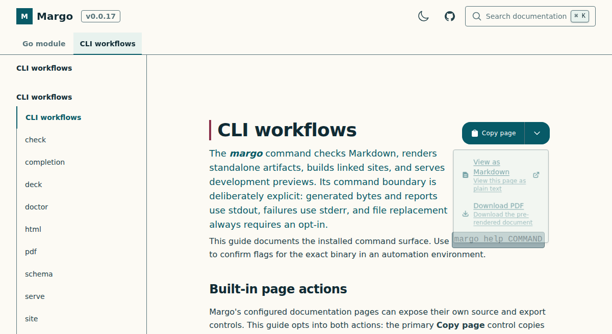

# `margo html`

## Purpose

`html` renders one complete standalone HTML document.

## Input and output

Input is one Markdown path or `-` for stdin. Output defaults to `-`, so HTML
bytes go to stdout unless `--output PATH` selects a file. Diagnostics go to
stderr and never mix with HTML bytes.

`--title` overrides the document title and accepts at most 256 UTF-8 bytes.
`--lang` overrides the BCP 47 document language. Local images are materialized
for the standalone artifact; unsupported or external resource forms are
rejected instead of producing a silently broken page.

## Built-in page actions

HTML documentation pages can expose source and export controls. The primary
**Copy page** control copies the published Markdown source, while its menu
offers **View as Markdown** and **Download PDF** for the same page. The
controls follow the active theme and remain keyboard-accessible.

Enable them in a page's frontmatter:

```yaml
margo:
  actions:
    markdown: true
    pdf: true
```



Raw HTML and iframe markup are denied by default. Use
`--allow-unsafe-html` (or `--allow-raw-html`) only when the host has reviewed
the document's arbitrary HTML content.

## Zoom and pan for images

Opt into the image viewer in the document's frontmatter, then give each
interactive image a title, which Margo renders as its caption:

```markdown
---
margo:
  imageViewer: true
---


```

Only a captioned image alone in its paragraph becomes interactive. Images
without captions, inline icons and linked thumbnails stay static. Omit the
preference or set it to `false` to keep all images static.

The controls match the Mermaid viewer: zoom in/out, fit, expand and fullscreen.
**Actual size** reaches the original image's pixel dimensions, including for
large screenshots fitted into narrow columns. The zoom percentage is relative
to the fitted view. Drag a zoomed image with the primary or middle mouse button,
or pan with touch. Focus its image area to use `+`/`-`, `0`/`Home` to fit, and
arrow keys to pan; Ctrl+wheel zooms around the pointer. Escape closes an
expanded view and restores focus and the article's reading position.

Alt text and captions remain available in both views. Without JavaScript the
original image remains usable. Printing, PDF output and presentation decks use
static images. Generated sites support the same frontmatter and controls.

## Examples

```sh
margo html docs/guide.md \
  --title "Publishing guide" \
  --lang en \
  --output build/guide.html

margo html docs/guide.md | gzip -9 > build/guide.html.gz
```

Replace an existing output only when intended:

```sh
margo html docs/guide.md --output build/guide.html --force
```

## Failures and diagnostics

The file sink is atomic and refuses an existing destination with
`margo.atomic.destination_exists`. Invalid language or title metadata reports
`html.metadata_invalid`. Input, policy, parser, resource, and output failures
exit `1` without committing a partial destination.

## Limitations and care

`html` builds one page; it does not rewrite links across a directory or create
a site manifest. Review the [CLI overview](../index.md) before supplying a
trusted policy or using stdin with relative resources.
