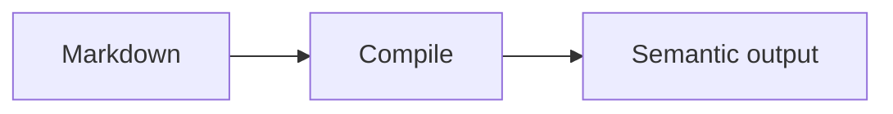

# Mermaid fence

Use a `mermaid` fence for diagrams. Margo assigns deterministic IDs, applies a
known Mermaid runtime, and sanitizes the resulting SVG before publication.

In HTML documents and sites, each rendered diagram has **Zoom in**, **Zoom out**,
and **Fit diagram** controls. Focus the diagram and use `+` / `-` to zoom, `0`
or `Home` to fit, and arrow keys to pan. You can also drag with a mouse or swipe
on a touch screen after zooming. Each diagram keeps its own view. Page scrolling
and browser pinch zoom remain available.

The complete source remains available to assistive technology. Without
JavaScript, the source disclosure remains available. Printed pages and PDF
exports use the full static diagram and omit the interactive controls.

## Source

````markdown

````

## Result


## Options

The fence body is Mermaid syntax. Choose the diagram family in the first line
(`flowchart`, `sequenceDiagram`, and others supported by the pinned runtime).
Margo owns deterministic IDs and SVG sanitization; arbitrary runtime
configuration is not accepted in the document body.
