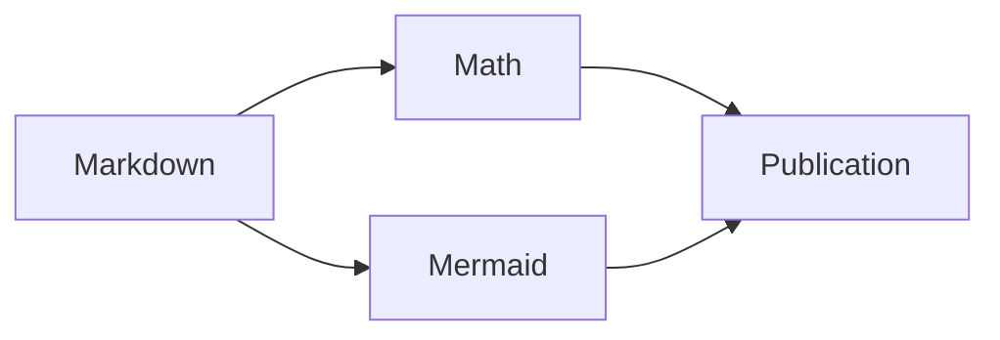

# Math in Margo

Inline math keeps the reading flow: $E = mc^2$. Currency remains ordinary
text: $20 and $30.

## Compact display

$$a^2 + b^2 = c^2$$

## Multiline display

$$
\int_0^\infty e^{-x^2}\,dx = \frac{\sqrt{\pi}}{2}
$$

## Fenced math

```math
\begin{aligned}
\nabla \cdot \mathbf{E} &= \frac{\rho}{\varepsilon_0} \\
\nabla \cdot \mathbf{B} &= 0
\end{aligned}
```

## Matrices

```math
A = \begin{pmatrix}1 & 2 \\ 3 & 4\end{pmatrix}
```

## Shared runtime



## Literal source

Code spans such as `$x$` remain code. A `latex` fence shows source:

```latex
\frac{a}{b}
```
